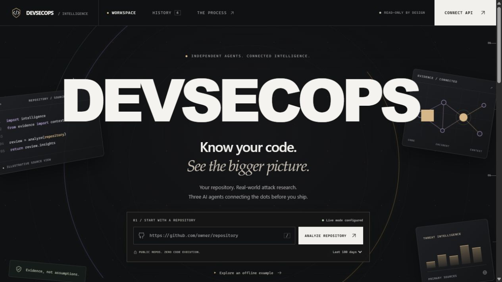
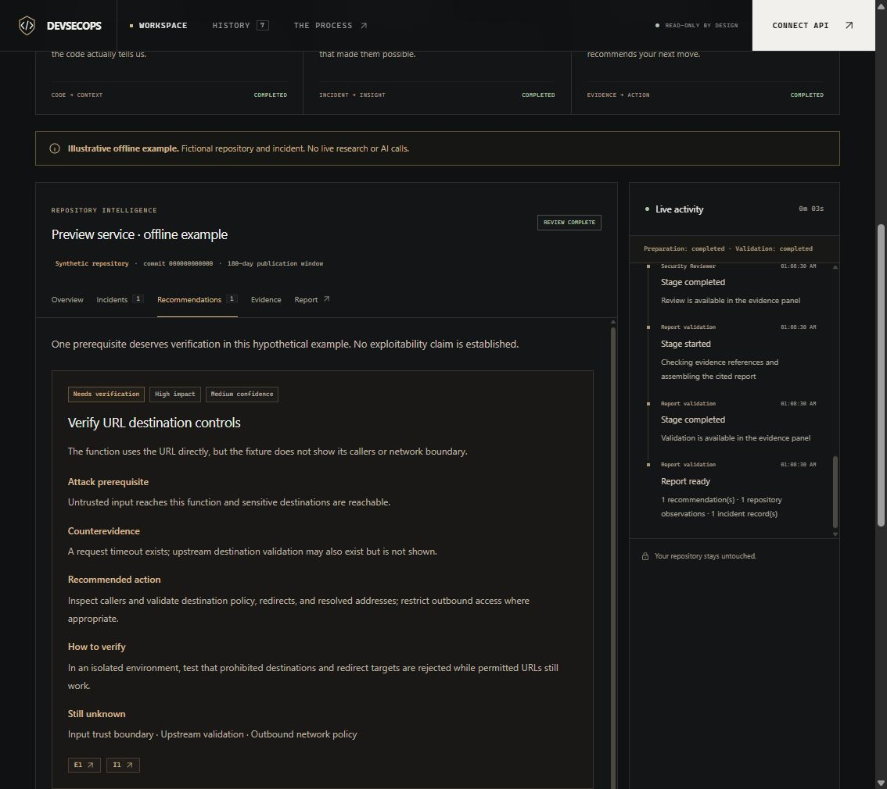
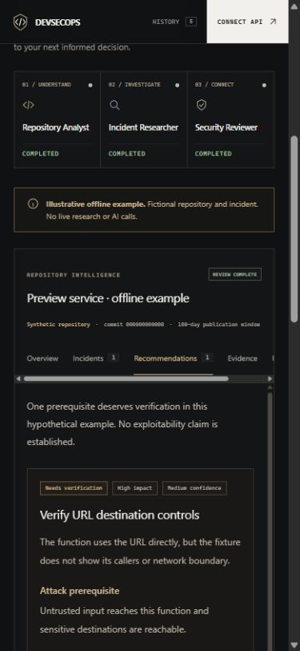
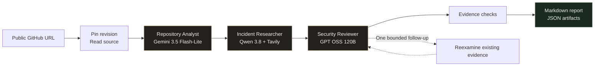
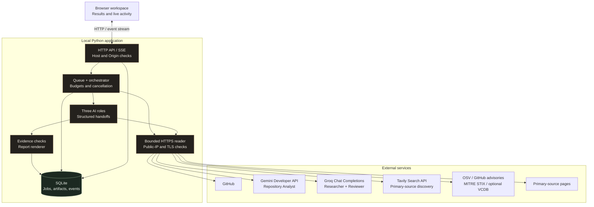
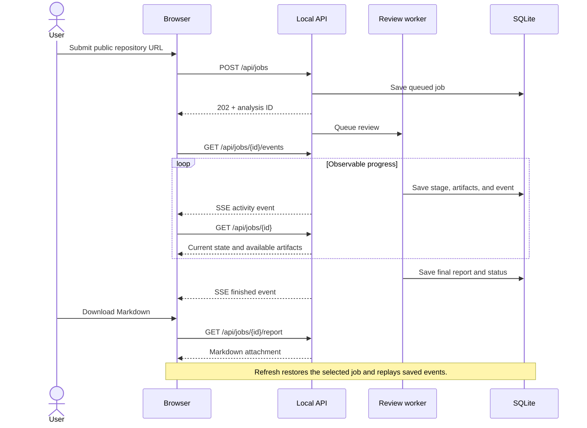

<div align="center">


# DevSecOps

### Know your code. See the bigger picture.

**Incident-informed security reviews for builders.**

One public GitHub URL. Three AI roles. A traceable path from source code to preventive action.

[](https://www.python.org/)


[](https://www.sqlite.org/)
[](pyproject.toml)

<br>

[Quick start](#quick-start) · [The workspace](#the-workspace) · [How it works](#how-it-works) · [Architecture](#architecture) · [Example report](docs/examples/offline-report.md)

</div>

<br>



> **Current scope:** a local, static, read-only review assistant. It investigates repository evidence and documented attack mechanisms; it does not establish production exposure, execute target code, exploit weaknesses, or apply fixes.

## Why this project exists

A security incident elsewhere can teach you something about your own application—but sharing a language or framework with a breached company is not enough to establish a shared weakness.

DevSecOps connects **documented attack prerequisites** to **observations from your repository**. It records the missing context, acknowledges existing defenses, and turns supported connections into concrete recommendations and verification steps.

The central question is:

> Which documented attack mechanisms have prerequisites supported by this repository, and what should its builders verify or change?

### At a glance

| Capability | What it gives you |
| --- | --- |
| **Three specialized AI roles** | Separate repository analysis, incident research, and security review with structured handoffs. |
| **Commit-pinned source evidence** | File references and line ranges tied to the exact revision inspected. |
| **Primary-source research** | Retrieved technical reports and source passages, rather than unverified links generated in prose. |
| **Visible investigation** | Live activity, stage states, inspected evidence, and saved intermediate artifacts. |
| **Explicit uncertainty** | Supported concerns, verification questions, background lessons, and rejected matches stay distinct. |
| **Existing-defense awareness** | The reviewer is instructed to look for controls and counterevidence before recommending a change. |
| **Portable outputs** | A cited Markdown report and JSON artifacts for review, sharing, or further inspection. |
| **Local operation** | A browser workspace and CLI using Python's standard library, with SQLite persistence. |

---

## The workspace

The interface follows the review from repository inspection to the final report. Its dark visual system includes responsive layouts, keyboard navigation for result tabs, and reduced-motion support.

**The dashboard below shows the fictional offline example. It is not a real incident investigation or a finding against a real repository.**



| View | What you can inspect |
| --- | --- |
| **Overview** | Technology, application components, cited observations, coverage, and open questions. |
| **Incidents** | Attack mechanisms, prerequisites, source passages, victims when documented, and separate dates. |
| **Recommendations** | Relevance classifications, impact, confidence, counterevidence, actions, and verification steps. |
| **Evidence** | Inspected file references, code excerpts, skipped files, and validation results. |
| **Report** | Markdown preview, download, clipboard copy, and JSON artifact export. |

<details>
<summary><strong>See the mobile review experience</strong></summary>

<br>



The mobile interface retains the evidence, uncertainty labels, result tabs, and activity stream. This screenshot also uses the synthetic offline example.

</details>

## Quick start

### Requirements

- **Python 3.11 or later.**
- Git, if cloning the repository.
- A browser for the workspace.
- Internet access and Gemini, Groq, and Tavily API keys **only for live analysis**.

There are **no third-party runtime packages to install**, no frontend build step, and no required database service. Node.js is optional for a JavaScript syntax check during development.

### Launch the application

```sh
git clone https://github.com/saubhagya7dev/DevSecOps.git
cd DevSecOps
python run.py
```

Open **[http://127.0.0.1:8765](http://127.0.0.1:8765)**.

If your system uses `python3` instead of `python`, substitute that command. An alternative port is available with `python run.py --port 8766`.

### Explore without credentials

Click **Explore an offline example**.

This runs a deliberately fictional repository and incident through the workflow, including citation checks, saved artifacts, and report generation. **It makes no model or internet research calls.** A failed live run is never silently replaced with this example.

You can inspect the same outputs directly:

- [Synthetic example report](docs/examples/offline-report.md)
- [Synthetic example artifacts](docs/examples/offline-report.json)

## Configure live analysis

Create a local `.env` file. **If one already exists, edit it directly instead of running the copy commands below.**

**PowerShell**

```powershell
Copy-Item .env.roles.example .env
```

**macOS / Linux**

```sh
cp .env.roles.example .env
```

Edit the file locally:

```dotenv
GEMINI_API_KEY=your-gemini-api-key
GROQ_API_KEY=your-groq-api-key
TAVILY_API_KEY=your-tavily-api-key
ANALYST_MODEL=gemini-3.5-flash-lite
RESEARCHER_MODEL=qwen/qwen3.8-27b
REVIEWER_MODEL=openai/gpt-oss-120b
GITHUB_TOKEN=
PORT=8765
```

Then restart `python run.py` and refresh the browser.

| Variable | Required | Purpose |
| --- | --- | --- |
| `GEMINI_API_KEY` | Live mode only | Google Gemini Developer API authentication for the Repository Analyst. |
| `GROQ_API_KEY` | Live mode only | Groq authentication shared by the Incident Researcher and Security Reviewer. |
| `TAVILY_API_KEY` | Live mode only | Tavily search authentication; separate from model inference. |
| `ANALYST_MODEL` | No | Gemini model; defaults to `gemini-3.5-flash-lite`. |
| `RESEARCHER_MODEL` | No | Groq model; defaults to `qwen/qwen3.8-27b`. |
| `REVIEWER_MODEL` | No | Groq model; defaults to `openai/gpt-oss-120b`. |
| `GITHUB_TOKEN` | No | Public GitHub API authentication; required for optional VCDB code-search discovery. |
| `RESEARCHER_TOKEN_BUDGET` | No | Conservative input-plus-output allowance; defaults to `1000`. Raise only after verifying account quota. |
| `ENABLE_VCDB` | No | Set `1` for bounded official historical-record discovery; defaults to `0`. |
| `PORT` | No | Local HTTP port; defaults to `8765`. The `--port` flag overrides it. |

Existing environment variables take precedence over `.env` values. Provider access, model compatibility, and billing are not verified merely because a key is configured.

**Keep credentials on the server.** Never commit actual keys, add them to a repository URL, or paste them into the interface. The browser receives a configuration flag, not the API key. Live model and search calls incur provider charges; actual cost depends on usage and your provider configuration.


### Verify the live APIs

After setting your credentials, run:

```sh
python run.py --check-apis
```

This makes three small model requests (one per configured role), one Tavily search, and one GitHub metadata request. It checks authentication, actual model inference, each role's JSON contract, primary-source search results, and GitHub access. Model output is capped at 2,048 tokens per request. Provider charges may apply.

Each integration prints `PASS`, `FAIL`, or `MISSING` with elapsed time. A failure does not prevent the remaining checks. Exit code `0` means all five integrations passed; code `1` means at least one failed or lacks credentials. Keys and raw provider responses are never printed. The command does not start the server or analyze a repository.

The displayed model IDs reflect your effective configuration, including `.env` or environment overrides. The search check deliberately omits publication dates so it can test search access independently of recent-incident coverage. Empty search results are reported explicitly. Passing these checks does not establish full-review quality, future quota availability, or production exposure.

## How it works

Three specialized roles run sequentially under a deterministic controller. Each has its own hosted model, context, instructions, and JSON contract. Every response is validated locally before the next stage accepts it.

| Role | Hosted provider | Default model | Tools |
| --- | --- | --- | --- |
| Repository Analyst | Google Gemini Developer API | `gemini-3.5-flash-lite` | No model tools; backend supplies inspected files. |
| Incident Researcher | Groq | `qwen/qwen3.8-27b` | Generates queries; backend calls Tavily and fetches eligible pages. |
| Security Reviewer | Groq | `openai/gpt-oss-120b` | Reviews existing evidence; may request one bounded follow-up. |

**Migrating from the shared OpenAI setup:** merge the three credential settings into your existing `.env`, restart, and refresh the browser. `OPENAI_API_KEY` and `OPENAI_MODEL` are no longer used. The `openai/` prefix in the reviewer model ID identifies the model publisher; requests go to Groq using `GROQ_API_KEY`. There is no silent model or provider fallback. Optional model overrides must support the same structured-output API features.



### 1. Understand the repository

The backend validates the URL, resolves the default branch to a commit SHA, and selects a bounded set of readable files. It does not clone and execute the project or install its dependencies.

The **Repository Analyst** produces:

- A project overview and component map.
- Observed technologies and version information where supported.
- Security-relevant behavior, such as authentication, uploads, or outbound requests.
- File-backed observations, research questions, and unknowns.

Each observation must reference a real inspected path, inclusive line range, and matching excerpt. Redacted lines cannot become accepted source evidence. Architectural inferences remain distinguishable from direct observations.

### 2. Research relevant incidents

The **Incident Researcher** searches for mechanisms and prerequisites relevant to the profile, including application, identity, cloud, CI/CD, and supply-chain patterns when the inspected evidence supports those questions.

The current search allowlist covers:

| Source | Research context |
| --- | --- |
| [The DFIR Report](https://thedfirreport.com/) | Individual technical intrusion reports. |
| [CISA](https://www.cisa.gov/news-events/cybersecurity-advisories) | Technical advisories and observed campaigns. |
| [Google Threat Intelligence / Mandiant](https://cloud.google.com/blog/topics/threat-intelligence) | Technical incident investigations and threat research. |
| [Microsoft Security](https://www.microsoft.com/en-us/security/blog/) | Identity, cloud, application, and supply-chain attack analyses. |
| [Google Security Blog](https://security.googleblog.com/) | Security research and incident context. |
| [GitHub Blog](https://github.blog/security/) | Developer and software supply-chain security. |
| [Cloudflare Blog](https://blog.cloudflare.com/) | Application, network, and infrastructure security research. |
| [Unit 42](https://unit42.paloaltonetworks.com/) | Threat intelligence and incident analysis. |
| [PyPI Blog](https://blog.pypi.org/) | First-party package ecosystem incident investigations. |
| [JFrog Security Research](https://research.jfrog.com/) | Original software supply-chain and malicious-package research. |
| [Wiz Research](https://www.wiz.io/blog) | Original cloud and software supply-chain incident analysis. |

Qwen first generates up to two bounded search queries. The backend submits them to Tavily with the primary-source domain allowlist and publication-window dates. If no useful evidence survives retrieval or quote-validated extraction, one reserved deterministic query broadens the search without a date filter; older and undated results remain explicitly labeled. Candidates are interleaved across queries. Weekly vulnerability indexes, community answers, and product tutorials are excluded from incident discovery. Candidate URLs come from **Tavily metadata and Python-normalized official advisory/knowledge references**. URLs merely written in model-generated prose are ignored. The backend independently retrieves eligible pages before they can support an incident record, and checks that the cited passage exists in the fetched text.

Article/main content is preferred over navigation. Full fetched text is retained up to the per-page context bound, while incident extraction receives selected contiguous passages totaling at most **6,000 characters** across sources. Extraction receives source passages without the target profile, so missing proof of target compromise cannot be used to discard a documented external incident. Repository relevance and prerequisites are assessed separately by the Reviewer. Accepted quotes must still match the retained source text. The reviewer receives at most four accepted incident summaries and sixteen compact repository observations, rather than full HTML-page text. These context bounds can omit relevant details and are recorded as limitations.

The default research window is **180 days by publication date**. Publication date, incident date, and retrieval timestamp remain separate. Older and undated material is explicitly labeled; an advisory is not automatically an observed attack, and a useful campaign need not name its victims.

Structured discovery adds OSV and GitHub global advisories, official MITRE ATT&CK normalization, and optional historical VCDB discovery. Advisory records, technique candidates, historical records, and observed incidents remain distinct. See [incident discovery configuration, budgets, caching, and evidence rules](docs/incident-discovery.md).

### 3. Review the connection

The **Security Reviewer** compares an attack's requirements against the accepted repository evidence. It is instructed to look for existing defenses, reject weak matches, and preserve uncertainty.

Every accepted recommendation needs an evidence chain:

```text
Documented mechanism
    → Required condition
    → Repository observation
    → Counterevidence and missing context
    → Preventive recommendation
    → Verification step
```

The reviewer can request **one bounded follow-up** to reexamine material already acquired. That request does not grant additional deployment access or trigger unrestricted crawling.

### 4. Validate and report

The backend checks handoff structure, evidence IDs, source passages, and repository citations before rendering the report.

Invalid references are rejected. A concern supported only by inferred repository observations is downgraded to **Needs verification**. If no defensible incident connection exists, an empty recommendation set is a valid outcome.

> **Reference integrity is not semantic proof.** A matching passage confirms that the text exists; it does not independently establish that the AI interpreted it correctly.

## Architecture

The application uses a standard-library Python backend and a buildless HTML/CSS/JavaScript frontend. A single worker processes queued reviews, while the HTTP server handles browser requests and event streams.



The model does not decide its own permissions. Repository access, page retrieval, storage, and stage transitions are controlled by backend code. The MVP has no shell tool, MCP server, A2A protocol, vector database, or independent agent processes.

<details>
<summary><strong>Live updates, refresh recovery, and report delivery</strong></summary>

<br>



The activity feed shows observable operations and concise explanations—not private model reasoning. Closing a browser tab does not cancel the job. Restarting the server marks interrupted jobs as failed while retaining saved artifacts.

</details>

## Reading a report

| Classification | Meaning | Appropriate next step |
| --- | --- | --- |
| **Supported concern** | Observed repository evidence supports a relevant attack prerequisite. | Review the cited code and verify remaining exploit conditions. |
| **Needs verification** | The connection depends on missing version, configuration, trust-boundary, or deployment evidence. | Resolve the specific open questions before drawing a conclusion. |
| **Background lesson** | Useful context without evidence of the required repository weakness. | Treat it as background guidance, not a detected vulnerability. |

**Impact and confidence are separate qualitative labels.** They are not calibrated probabilities or a numeric security score. A supported concern is not proof of exploitation, and “no matches” is not a security clearance.

A report includes the project overview, coverage, incident sources, recommendations, existing defenses, rejected matches, and unresolved questions.

### Inspectable artifacts

| Artifact | Contents |
| --- | --- |
| `repository` | Commit identity, inspected files, returned tree coverage, and skipped-file details. |
| `profile` | Technologies, components, observations, research questions, and unknowns. |
| `research` | Retrieved source text, incident records, source passages, dates, and limitations. |
| `review` | Recommendations, classifications, counterevidence, defenses, and rejected matches. |
| `followup` | Optional request and answer from the bounded reexamination. |
| `validation` | Integrity checks, warnings, configured role models, per-role call/token usage, and Tavily request count. |

Repository observations use `E` IDs, incident records use `I` IDs, retrieved sources use `S` IDs, and recommendations use `F` IDs. These references connect the handoffs and final report.

## Command-line usage

The CLI shares the same orchestration pipeline as the browser application.

```sh
# Run the local browser application
python run.py

# Use another local port
python run.py --port 8766

# Generate a fictional offline report and neighboring JSON artifact
python run.py --demo --output test-output/example.md

# Review a real public repository using configured credentials
python run.py --repo https://github.com/owner/repository --output test-output/report.md

# Equivalent module entry point
python -m devsecops --demo --output test-output/example.md
```

The CLI research window is currently fixed at 180 days. The UI offers 90, 180, or 365 days; the local API accepts 7–730 days.

## Local API

The interface uses these endpoints. This is a loopback development API, not a publicly exposed service.

| Method | Endpoint | Purpose |
| --- | --- | --- |
| `GET` | `/api/config` | Credential readiness, role/provider/model mapping, missing key names, local request token, and example URL. |
| `GET` | `/api/jobs` | Up to 50 recent job summaries. |
| `POST` | `/api/jobs` | Create a `live` or `demo` review. |
| `GET` | `/api/jobs/{id}` | Job status, stage states, artifacts, and available report. |
| `GET` | `/api/jobs/{id}/events` | SSE activity feed; supports cursor-based replay. |
| `POST` | `/api/jobs/{id}/cancel` | Request cooperative cancellation. |
| `GET` | `/api/jobs/{id}/report` | Download the Markdown report. |
| `GET` | `/api/jobs/{id}/artifacts` | Download the JSON artifacts. |

Requests must satisfy local Host/Origin checks. Mutating requests also require the `X-Review-Token` returned by `/api/config`. The browser manages this automatically. This token is separate from provider API credentials.

## Security and privacy

| Boundary | Implemented behavior | Important limit |
| --- | --- | --- |
| **Target repository** | Reads public files from a pinned revision; does not install, import, execute, patch, or deploy them. | A bounded snapshot cannot establish actual production behavior. |
| **Network access** | Public-IP-pinned HTTPS, TLS validation, restricted ports, redirect checks, response-size limits, and private/local/reserved destination rejection. | Network controls do not prove source content trustworthy. |
| **Credentials** | Server-side keys; heuristic redaction of suspected secret lines; credential-file exclusions; authorization stripped on redirects. | Redaction can miss secrets and can over-redact legitimate text. |
| **Untrusted content** | Repository and webpage text are treated as evidence, with fixed role instructions and locally checked contracts. | Prompt injection can still affect interpretation; instructions alone are not a complete defense. |
| **Model authority** | No shell execution or repository-write tools are exposed. | AI recommendations still need human review. |
| **Browser access** | Loopback binding, Host/Origin checks, request tokens for mutations, and a restrictive Content Security Policy. | No multi-user authentication or production deployment hardening. |
| **Storage** | Jobs, redacted excerpts, artifacts, reports, and activity events persist locally in SQLite. | Local artifacts are plaintext; retention and filesystem access are the operator's responsibility. |

Live analysis sends inspected public source excerpts to Google Gemini, the accepted repository profile and fetched incident evidence to Groq, and generated search queries to Tavily. A bounded analyst follow-up returns to Gemini; a researcher follow-up returns to Qwen on Groq. Provider-side processing and retention follow each provider’s terms; local storage controls do not establish zero provider retention.

The optional GitHub token is used for GitHub API requests; it is not passed as model context or sent to incident-report sites.

Runtime data lives in the ignored `.devsecops/reviews.sqlite3` file; the bounded 24-hour discovery cache lives in `.devsecops/research-cache/`. The frontend uses local scripts, styles, and system fonts without external CDNs. There is no automatic retention policy in this MVP.

## Budgets and operational behavior

| Boundary | Current default |
| --- | --- |
| Active worker | One review at a time |
| Accepted queued/running/cancelling jobs | Five |
| Files read | 36 |
| Per-file download | 64,000 bytes |
| Per-file context | Up to 9,000 characters, retaining complete lines |
| Total repository context | Up to 100,000 characters |
| Primary page fetch attempts | Up to six; failed candidates can be replaced within this ceiling |
| Per-page download | Up to 8,000,000 bytes, HTML/text only |
| Per-page stored context | Up to 18,000 characters |
| Total source text sent for extraction | Up to 6,000 characters, selected contiguous passages |
| Groq request body | At most 18,000 UTF-8 bytes; a conservative size guard, not a tokenizer |
| Tavily search requests | Up to three; each returns at most six candidates |
| Model calls | Up to six, including an optional follow-up and re-review |
| Model output | Analyst: 6,500; query planning: 700; Groq full extraction/review: 2,300; low-quota extraction: 192; follow-up: 1,000 |
| Structured API/dataset requests | Up to twelve total, including retries; at most two bounded dataset downloads |
| Researcher token allowance | 1,000 conservative estimated tokens including schema/instructions and reserved output; configure only after verifying account quota |
| Model HTTP attempts | Up to nine: six logical calls plus at most three retries |
| Job deadline | 900 seconds, checked between operations |

At allowances below 4,000, Python plans searches and Qwen interprets one ranked passage through a compact contract. At the default 1,000 allowance, this uses at most 450 source characters and a 192-token output reserve. Exact transmitted quotations are assigned and checked in Python; dates and victims remain unknown. This mode prevents oversized requests but provides narrow research coverage; it does not guarantee incident relevance. See [the discovery design](docs/incident-discovery.md).

Defaults live in [config.py](devsecops/config.py), with request limits in [providers.py](devsecops/providers.py) and source selection in [incident_research.py](devsecops/incident_research.py). Increasing budgets changes coverage, latency, and potential provider cost.

**Cancellation is cooperative.** An in-flight network/model request can finish after cancellation is requested, and a provider charge may already have occurred.

A failed extraction retains retrieved sources and the provider error in the partial report. If no accepted incidents are available, the reviewer is marked **skipped**, rather than completed. The UI distinguishes research failure from a completed search with no supported matches.

A model request receiving HTTP 429 is retried at most once only when the provider supplies a `Retry-After` of at most 60 seconds. HTTP 503 also receives at most one retry, honoring a short reset or using a 1–3 second jittered wait when no reset is supplied. See [Gemini availability diagnostics](docs/gemini-availability.md). There are at most three retries per job; waits check cancellation. Requests larger than the reported token limit, daily quotas, missing reset information, and longer waits fail explicitly. Provider error bodies and organization IDs are not displayed; only safe status and rate-limit numbers are extracted. Byte limits and small output budgets cannot guarantee a fit for every account’s token quota.

A successful `--check-apis` smoke test confirms small-request access. It does **not** establish that full repository workloads fit your account’s token-per-minute/day limits. Check the [Groq Limits page](https://console.groq.com/settings/limits) and [rate-limit documentation](https://console.groq.com/docs/rate-limits) if throttling persists. A request larger than a model’s entire per-minute allowance cannot succeed just by waiting; raise that allowance or explicitly configure another compatible model.

## Development and verification

```sh
# Standard-library tests, including local HTTP integration
python -m unittest discover -v

# Python syntax check
python -m compileall -q devsecops run.py

# Optional JavaScript syntax check; requires Node.js
node --check web/app.js
```

The current suite contains **97 test cases** covering:

- Citation rejection, evidence-reference integrity, date handling, and unknowns.
- Retention of existing defenses and rejected matches in controlled fixtures.
- URL validation, DNS/private-network boundaries, redirects, and redaction.
- Gemini/Groq role routing, credential isolation, structured handoffs, and Tavily-returned source provenance.
- Incomplete/refused output rejection, shared call budgets, search failures, and provider key redaction.
- Local API protections, report delivery, and event replay.
- Cancellation, completion races, restart recovery, and partial results.
- Offline execution and a complete mocked model/search workflow, including the bounded follow-up.

API tests need permission to open and connect to loopback sockets. Temporary test data stays under ignored `test-output/`.

**Verification scope:** all 97 tests pass after the low-quota researcher fix, including the complete mocked Gemini/Groq/Tavily workflow and bounded follow-up. Earlier checks exercised the browser workflow, downloads, responsive layout, and public GitHub ingestion. Live API smoke checks are separate from a complete repository review; run `--check-apis` to verify your effective configuration. The four-repository live integration results and rerun command are recorded in [live verification](docs/live-verification-2026-10-31.md). The screenshots and included example report use offline fixtures. These checks are not a live-provider benchmark, a security audit, or evidence that generated recommendations are always correct.

### Project structure

```text
DevSecOps/
├── devsecops/
│   ├── cache.py           Bounded expiring discovery and extraction cache
│   ├── packages.py        Static package inventory and version uncertainty
│   ├── discovery.py       OSV and GitHub advisory adapters
│   ├── knowledge.py       Official ATT&CK and optional VCDB normalization
│   ├── sources.py         Individual technical-report eligibility
│   ├── incident_research.py  Ranked discovery and bounded fallback
│   ├── context.py         Bounded evidence views for hosted models
│   ├── providers.py       Gemini, Groq, and Tavily adapters
│   ├── diagnostics.py     Independent live API smoke checks
│   ├── agents.py          Three role implementations and source retrieval
│   ├── contracts.py       Strict JSON schemas and local shape validation
│   ├── repository.py      Commit-pinned, bounded GitHub reader
│   ├── network.py         Public-IP-pinned HTTPS and credential redaction
│   ├── evidence.py        Evidence checks and Markdown report rendering
│   ├── pipeline.py        Orchestration, follow-up, cancellation, partial results
│   ├── store.py           SQLite jobs, artifacts, and activity events
│   ├── server.py          Loopback HTTP API, static UI, and SSE
│   ├── config.py          Environment loading and analysis budgets
│   ├── demo.py            Explicitly fictional offline fixture
│   └── __main__.py        Server and CLI entry points
├── web/
│   ├── index.html         Repository review workspace
│   ├── styles.css         Responsive dark visual system
│   ├── app.js             Job submission, activity, evidence, and exports
│   └── favicon.svg        Code-shield identity
├── tests/                 Standard-library test suite
├── docs/
│   ├── assets/            Repository-hosted product screenshots
│   └── examples/          Fictional example report and JSON artifacts
├── .env.roles.example     Environment template; use placeholders only
├── MVP.md                 Product scope and acceptance criteria
├── pyproject.toml         Python project metadata
└── run.py                 Simple launcher
```

## Troubleshooting

| Symptom | What to check |
| --- | --- |
| **Live mode needs setup** | Set `GEMINI_API_KEY`, `GROQ_API_KEY`, and `TAVILY_API_KEY` in the server environment or local `.env`, restart the server, and refresh. |
| **HTTP 429 during research** | Inspect the reported limit/reset. The pipeline bounds payloads and retries short transient limits; oversized requests and daily quotas require smaller workloads or higher provider limits. |
| **Configured, but analysis fails** | A configured flag only means a key is present. Check account access, model compatibility, network access, billing, and the displayed upstream error. |
| **GitHub access/rate-limit error** | Confirm the repository is public and use an appropriate read-only `GITHUB_TOKEN` if needed. |
| **Invalid repository URL** | Supply `https://github.com/owner/repository`. Branch paths, file URLs, queries, private repositories, and non-GitHub hosts are unsupported. |
| **No readable files or sparse coverage** | Check file sizes, supported text types, excluded/generated content, context limits, and the coverage section. |
| **No matching incidents** | Inspect source-fetch limitations and the research window. PDF/JavaScript-only pages may be unavailable. No matches does not mean no risk. |
| **Partial report** | Read the research and validation limitations; available artifacts remain inspectable. |
| **Invalid local request token** | Refresh the page after a server restart. |
| **Port already in use** | Launch with `python run.py --port 8766`. |
| **Interrupted job after restart** | Start a new review. Saved artifacts from the old job remain available. |

## Limitations and next directions

The current version reviews a selected set of text files. It does not provide complete dependency resolution, call-graph reachability, an SBOM inventory, runtime monitoring, exploit testing, production configuration discovery, or compliance certification. It supports public repositories and reads HTML/plain-text research sources; PDF extraction and private-repository access are not implemented.

The model can misinterpret evidence, infer unsupported relationships, or overlook relevant controls. Shared technology alone must remain a background connection. Human review and deployment context are still required.

Potential next steps—**not current capabilities**—include:

- A larger, held-out repository–incident evaluation set with measured relevance and citation-support quality.
- Better source selection and language-aware repository indexing.
- More incident-source adapters and PDF extraction.
- Provider-aware token counting, retained-evidence resume, and configurable retention policies.
- Authenticated deployment and additional safeguards before any multi-user release.

## Contributing

Open an issue describing the problem or proposed behavior before a substantial change. Keep pull requests focused, document coverage/permission changes, and include relevant fixture or integration checks. Clearly label synthetic incidents and never present fixture output as real-world findings.

Do not include keys, personal runtime data, or sensitive disclosure details in public issues or commits. Coordinate a private reporting channel with the maintainer before sharing sensitive security reports.

## License

A `LICENSE` file has not been added to this repository. No project license is currently specified.

## References

- [MVP scope and acceptance criteria](MVP.md)
- [Google Gemini: generating content API](https://ai.google.dev/api/generate-content)
- [Groq: structured outputs](https://console.groq.com/docs/structured-outputs)
- [Groq: supported models](https://console.groq.com/docs/models)
- [Tavily: search API](https://docs.tavily.com/documentation/api-reference/endpoint/search)

---

<div align="center">

**Built for builders, with context.**

*Better evidence. More informed decisions.*

</div>
