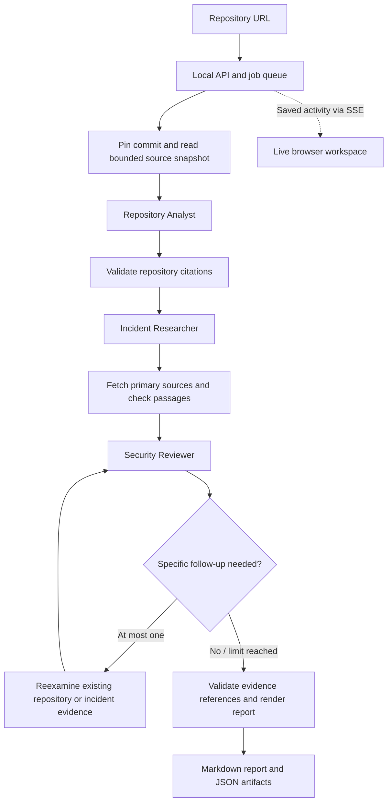

# DevSecOps · Repository intelligence

A local application that connects a public GitHub repository to documented attack mechanisms and produces a cited, preventive security review.

Three AI roles are implemented from the start: **Repository Analyst → Incident Researcher → Security Reviewer**. The browser shows live stage activity, intermediate artifacts, source passages, existing defenses, uncertainty, and downloadable Markdown/JSON. Analysis never executes the target repository or changes its files.

## Run locally

Requires Python 3.11 or later. There are **no third-party Python packages or frontend build steps**.

```powershell
cd D:\Code\Projects\DevSecOps
python run.py
```

Open [http://127.0.0.1:8765](http://127.0.0.1:8765). If the port is occupied, use `python run.py --port 8766`.

Choose **Try offline example** to explore the complete interface immediately. That option uses a clearly labeled fictional repository and fictional incident. It performs no model calls or live research, and is never substituted for a failed live run.

## Enable live analysis

```powershell
Copy-Item .env.example .env
```

Edit `.env` locally, then restart the server:

```dotenv
OPENAI_API_KEY=your-key-here
OPENAI_MODEL=gpt-4.1
GITHUB_TOKEN=
PORT=8765
```

- The OpenAI API key needs access to the configured model and Responses API web search. The default is configurable; the app does not assume that every account/model has access. Live calls incur provider charges.
- `GITHUB_TOKEN` is optional and is sent only to the initial GitHub API destination, never to source pages or the model. Use a token suitable for public read-only API access. Without it, GitHub's public API rate limit can constrain analyses.
- Keys remain in the server environment. The browser receives only a configured/not-configured flag. Do not paste credentials into repository URLs, the UI, or chat. `.env` is ignored by Git.
- Public repository excerpts and retrieved public source text are sent to OpenAI during live runs (`store: false`). Suspected credential lines are redacted before model handoff, but this is not comprehensive secret detection.
- A configured key does not establish valid billing or model access. Provider errors are displayed rather than hidden.

## Workflow



The roles are separate model calls with strict JSON contracts and different context/tool access. They may share one model; no separate model training is required. The controller owns all network and storage actions. Repository or source content cannot grant permissions. A reviewer may ask one bounded follow-up to reexamine **already acquired** evidence; additional crawling and deployment access are outside this version.

The researcher uses OpenAI's built-in web search, then the backend independently fetches cited pages. Only provider-returned citation/source metadata supplies candidate URLs; URLs merely generated in model prose are ignored. Search currently covers CISA, Google Threat Intelligence, Microsoft, Google Security Blog, GitHub Blog, Cloudflare Blog, and Unit 42. A source must be fetched successfully before it can support an incident record. HTML and plain text are supported; PDF and JavaScript-only pages may be unavailable.

The default window is **180 days by report publication date**, configurable in the UI. Incident date, publication date, and retrieval date are distinct. Older or undated sources receive explicit labels. An advisory is not automatically treated as an observed attack, and unnamed campaigns are valid evidence.

## Report semantics

- **Supported concern:** observed repository evidence supports a relevant attack prerequisite. This is still not proof of exploitability or production exposure.
- **Needs verification:** a plausible connection needs missing version, configuration, trust-boundary, or deployment evidence.
- **Background lesson:** relevance without a supported repository weakness; shared technology alone belongs here.
- Existing defenses and rejected matches are retained.
- No supported matches is a valid result, not a declaration of security.

Mechanical validation checks exact code passages and line ranges, fetched incident passages, and evidence-ID integrity. A second AI role evaluates relevance and counterevidence. **These checks do not independently prove semantic correctness.** Treat outputs as review aids.

## Limits and operation

| Boundary | Default |
| --- | --- |
| Worker concurrency | One review at a time |
| Pending/running review limit | Five |
| Files read | 36 |
| Per-file download | 64 KB |
| Per-file context | 9,000 characters, complete lines |
| Total repository context | 100,000 characters |
| Primary pages fetched | Six |
| Per-page context | 18,000 characters |
| Search tool calls | Up to three |
| Model calls | Up to six, including one optional follow-up and re-review |
| Output tokens | Up to 6,500 per call |
| Overall job deadline | 15 minutes, checked between operations |

Limits are centralized in `devsecops/config.py` and the model adapter. The model's context also includes schemas and instructions. This is a bounded source review, not complete reachability analysis, an SBOM inventory, or a vulnerability scan. Large files, generated/vendor content, unsupported content, skipped files, and truncated trees affect coverage and are disclosed. Do not treat an unobserved defense as an absent defense.

Cancellation is cooperative: an in-flight network/model request may finish, and its charge may already have been incurred. Saved artifacts remain available. Reloading the browser restores the selected job and replays persisted events. Interrupted jobs are marked failed on server restart. The current MVP does not retry external provider failures automatically; start another run after resolving access/rate-limit errors. Research failures can produce a partial report without incident-linked recommendations.

The HTTP server binds only to `127.0.0.1`. It enforces Host/Origin checks and a same-origin request token for mutations. It is a **local development server**, not an authenticated multi-user production service. Outbound HTTPS resolves and pins public IPs, validates TLS, blocks private/local/reserved destinations, strips authentication on redirects, and limits response sizes. Target code is not installed, imported, or executed. No model shell tools are exposed.

Jobs, redacted source excerpts, report artifacts, and activity events are saved locally in ignored `.devsecops/reviews.sqlite3`. There is no automatic retention policy in this MVP. The UI is served from `web/` without external scripts, fonts, or CDNs.

## CLI

```powershell
# Fictional, offline example; no credentials needed
python run.py --demo --output test-output/example.md

# Live review; requires configured credentials and internet access
python run.py --repo https://github.com/owner/repository --output test-output/report.md
```

The CLI also writes a neighboring JSON artifact file. Running without `--repo` or `--demo` starts the browser application.

## Verification

```powershell
python -m unittest discover -v
python -m compileall -q devsecops run.py
node --check web/app.js
```

Node is optional and needed only for the JavaScript syntax check. Tests use the Python standard library and controlled fixtures/mocks. API integration tests open loopback sockets; the environment must permit them. Test temporary files stay inside ignored `test-output/`.

The suite covers evidence rejection, source provenance, date handling, existing defenses, uncertainty, network boundaries, local API protection, event replay, cancellation, restart recovery, offline execution, and mocked live orchestration. A real GitHub ingestion smoke test was performed against `octocat/Hello-World`. **Live model/search execution requires an API key and has not been verified in this workspace.**

## Source layout

```text
devsecops/
  agents.py       Model adapter and three roles
  contracts.py    JSON handoff schemas and local validation
  repository.py   Commit-pinned, bounded GitHub reader
  network.py      Public-IP-pinned HTTPS and credential redaction
  evidence.py     Citation validation and Markdown generation
  pipeline.py     Orchestration, follow-up, cancellation, partial results
  store.py        SQLite jobs, artifacts, and replayable events
  server.py       Loopback HTTP API and SSE
  demo.py         Explicitly synthetic offline fixture
web/              Buildless browser workspace
tests/            Standard-library test suite
```

API implementation references: [Responses structured outputs](https://developers.openai.com/api/docs/guides/structured-outputs), [web search and source metadata](https://developers.openai.com/api/docs/guides/tools-web-search).
