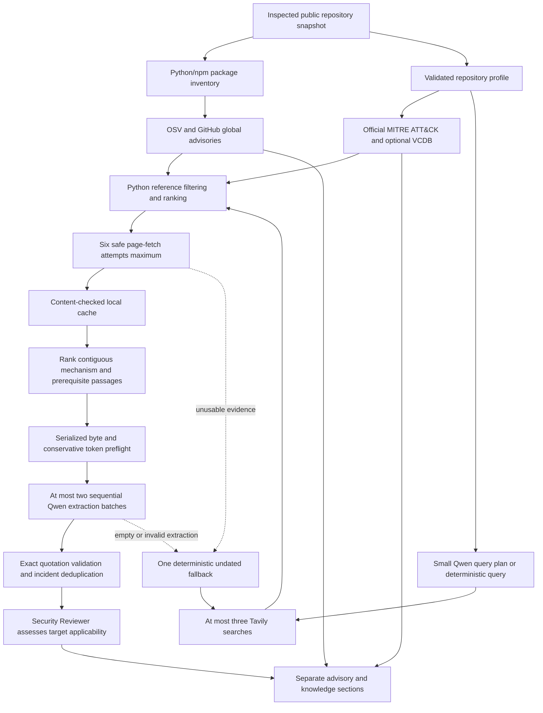

# Incident discovery and evidence boundaries

The Incident Researcher remains Groq `qwen/qwen3.8-27b`. The Repository Analyst and Security Reviewer keep their existing providers and models. Retrieval, package matching, caching, ranking, deduplication, and ATT&CK identifier normalization run in Python's standard library. No target code is executed and no malware artifacts are downloaded.



## Sources and official APIs

Individual technical reports are eligible from The DFIR Report, Google Threat Intelligence/Mandiant, Microsoft Security/Threat Intelligence, Unit 42, and Wiz Research. Existing CISA advisories, Google Security Blog, GitHub Security Blog, Cloudflare Blog, PyPI Blog, and JFrog Security Research remain supported.

Eligibility is defined by exact host and path patterns in [sources.py](../devsecops/sources.py), rather than arbitrary subdomain suffixes. Examples include DFIR's dated article URLs, Google Cloud `/blog/topics/threat-intelligence/...`, Microsoft's dated `/security/blog/...` posts, Unit 42 article slugs, and Wiz `/blog/...` reports. Homepages, category/index pages, tutorials, community answers, marketing titles, payload files, and search snippets cannot become incident evidence. Eligibility checks and content heuristics are not a guarantee of editorial or semantic correctness.

The public source URL is checked before acquisition and the final redirect URL must satisfy the same report rules. The existing public-IP-pinned TLS reader validates every redirect, blocks private/reserved destinations, and never forwards GitHub credentials to source sites. HTML article/main content is preferred over navigation. PDF, binary, and JavaScript-only reports are omitted with explicit limitations; no PDF dependency was added.

Structured discovery uses these official interfaces:

| Interface | Python processing | Evidence distinction |
| --- | --- | --- |
| [OSV query API](https://google.github.io/osv.dev/post-v1-query/) | Package/ecosystem lookup; exact version when available; aliases, affected ranges, fixes, references, withdrawal filtering | Vulnerability advisory; not an observed incident |
| [GitHub global advisories](https://docs.github.com/en/rest/security-advisories/global-advisories) | `ecosystem` and `affects` filters; identifiers, ranges, fixes, reference URLs; merge aliases with OSV | Vulnerability advisory; not proof of exploitation |
| [Official MITRE ATT&CK STIX data](https://github.com/mitre-attack/attack-stix-data) | Normalize active techniques; ignore revoked/deprecated techniques; retain two bounded procedure examples per technique and their references; rank at most three candidates | Technique/background mechanism; not independent incident proof |
| [VERIS Community Database](https://github.com/vz-risk/VCDB) | Optional GitHub code search of official validated JSON records; one keyword query and at most three validated blob records; normalize dates, references, and sparse summaries | Historical record with explicit technical-detail limitation |

OSV/GitHub/MITRE/VCDB references enter the same precise original-report eligibility and safe acquisition pipeline as Tavily results. Raw API responses, complete datasets, and search-result snippets are never sent to Qwen. A reference that cannot be fetched and checked is not incident evidence.

## Package and version uncertainty

Only already inspected files supply the package inventory: `package.json`, modern `package-lock.json`, Python requirements, `pyproject.toml`, `poetry.lock`, and `uv.lock`. Parsing is static; the application does not install dependencies or resolve ranges.

Lockfile versions take precedence over manifest declarations. Exact declaration pins remain labeled **exact declaration**, not confirmed installations. Version ranges, wildcards, Git URLs, and unresolved names never become installed versions. Package-name-only API queries retain an explicit applicability limitation. Advisory ranges and provider-reported fixes are shown without a homegrown cross-ecosystem version solver. Other ecosystems, truncated manifests, omitted packages, and pagination are reported as incomplete coverage.

## Fixed and separate resource budgets

The previous model/search/page-fetch ceilings are preserved. Structured discovery adds independently bounded HTTP work; it does not increase Qwen's call budget.

| Resource | Ceiling |
| --- | --- |
| Logical model calls across all roles | Six |
| Model retries | One per request, at most three per job; only short transient limits |
| Tavily searches | Three total, including undated fallback |
| Narrative acquisition | Six network fetch attempts, with at most six stored sources; first phase reserves capacity for fallback |
| Narrative download / retained text | 8 MB / 18,000 characters per page |
| Extraction interpretation | At most two sequential batches, each selecting up to 3,000 source-text characters; 6,000 shared per job |
| Groq serialized request | 18,000 UTF-8 bytes |
| Structured API/dataset requests | Twelve total, including retries |
| Dataset downloads | At most two within the twelve-request ceiling; 64 MB per dataset |
| Ordinary structured response | 2 MB |
| Structured transient retries | At most one, with `Retry-After` no greater than 30 seconds, within the twelve-request ceiling |
| Package coverage | At most 24 inventoried packages; three queried against OSV and GitHub |
| Structured advisory output | At most 24 merged records |
| Candidate ranking | At most 1,024 pool entries ranked in Python; 64 eligible unique URLs retained |
| ATT&CK candidates sent toward extraction | At most three IDs/names; no complete STIX data |
| VCDB | Disabled by default; one keyword query and at most three small official JSON records when enabled |
| Overall job | 900 seconds, cooperatively checked between operations and during retry waits |

The official MITRE enterprise STIX bundle was approximately 55.3 MB when checked during implementation, below the new dataset ceiling. That does not change the 8 MB narrative-page limit or the 18,000-byte model-request ceiling. Only a compact normalized index is cached; complete STIX JSON is not stored as a job artifact or submitted to a model. A larger future bundle fails explicitly within the fixed download bound.

Before each researcher request, the serialized JSON body is measured and input tokens are conservatively estimated as UTF-8 bytes divided by two, including instructions and schema. An output reserve is added. This is a conservative heuristic, **not** the provider tokenizer and **not** proof of remaining account quota.

`RESEARCHER_TOKEN_BUDGET` defaults to **1,000** because the previously tested Qwen account reported that allowance. Reserved output is capped at one-third of this allowance and never exceeds the existing call-specific output cap. Sequential researcher calls also reserve this conservative allowance against a shared local rolling-minute window, including across jobs in the same server process. Pacing waits check cancellation and the job deadline. External processes or other users of the provider account remain outside this local estimate. Estimated researcher attempts, including retries, share a job allowance of three times the configured per-request budget. There is no parallel researcher inference and no automatic model call per source.

Oversized views are rebuilt locally by removing lower-priority sources/passages and optional technique context, without changing source IDs or stored evidence. If instructions/schema alone cannot fit, the request is stopped **before transmission**. Planning falls back to deterministic discovery; blocked extraction preserves sources and structured records in a clearly partial result. Raise the allowance only after verifying that the account actually permits it. A stronger model's context window does not increase account quota.

HTTP 429 requests larger than the reported token limit, daily quotas, missing reset information, and long waits are not repeatedly retried. The existing model policy permits one retry only for a transient `Retry-After` up to 60 seconds, within the job/retry/token budgets. No model/provider fallback or offline-example substitution occurs.

## Fallback and coverage

The first acquisition/extraction phase uses dated discovery. A reserved deterministic query combines an observed package/technology and an observed attack mechanism. It removes the publication filter when no usable relevant evidence survives page retrieval or quotation-validated extraction—even when initial URLs existed.

Failed pages are replaced from the ranked pool within the six-attempt acquisition budget. New fallback sources can trigger a second small extraction only if source-text, model-call, estimated-token, and runtime budgets permit it. A reviewer call is reserved. Tavily transient retries consume the same three-search ceiling, and narrative hosts advertising `Retry-After` are deferred while other eligible hosts may replace them. If fallback uses an extra model call, an unaffordable follow-up/re-review is omitted and retained as an open question. A failed follow-up or re-review retains the prior evidence and partial report, records the unresolved question, and downgrades unsupported concerns.

Coverage artifacts record API/dataset work, cache hits, fetch attempts, candidate counts, unvisited candidates, extraction attempts, and source-text selection. Context reductions are reported as limitations. No relevant incident within searched coverage, incomplete retrieval/provider work, and external evidence with unverified target applicability are distinct outcomes.

## Evidence and ATT&CK matching

The Researcher extracts external facts; it never requires the target repository to be an already proven victim. The Reviewer checks applicability, prerequisites, defenses, counterevidence, and missing deployment context.

Every accepted narrative quote must be a contiguous 40–800-character passage in retained fetched text. Date normalization does not turn publication dates into incident dates. Multiple reports are conservatively merged by matching named victim, normalized title, incident date, and category, or by an identical supporting passage within the same report when the victim is undisclosed. Secondary source quotes are independently revalidated. Shared CVEs or techniques alone never merge different incidents. This conservative heuristic is not a general event-resolution system.

Explicit ATT&CK IDs in accepted source passages are matched against official active technique IDs first. At most three lexical candidates are supplied as optional interpretation context. A lexical candidate or model-written ID without supporting source evidence is not an accepted mapping. Unsupported mechanisms remain **unmapped**; there is no separate mapping model call.

Advisories, ATT&CK/background mechanisms, historical VCDB records, and documented external incidents remain separate artifact/report/UI sections. Background mechanisms alone cannot establish a supported concern. Sparse VCDB records retain an explicit warning that technical mechanisms and prerequisites are unverified.

## Configuration, caching, and access

Existing model credentials and provider settings are unchanged. Optional settings in `.env.roles.example` are:

```dotenv
RESEARCHER_TOKEN_BUDGET=1000
ENABLE_VCDB=0
GITHUB_TOKEN=
```

OSV and the official MITRE download require no key. Public GitHub advisories can be queried without authentication; the optional `GITHUB_TOKEN` can improve access limits. VCDB's bounded code-search discovery requires a GitHub token with access to public code search. GitHub account/search limits or indexing may still prevent results. Tokens are used only for fixed GitHub API endpoints.

The cache is local at `.devsecops/research-cache/` with a 24-hour TTL, at most 64 files, and a 2 MB entry ceiling. API pages, filtered Tavily metadata, normalized knowledge, retrieved page content, and structured extraction results are cached. Search snippets are discarded and never cached as evidence. GitHub/OSV pagination beyond the first bounded page is omitted explicitly. Narrative and structured-record retrieval timestamps remain the original acquisition timestamps on cache hits. TTL controls freshness, not secure deletion: expired files can remain until replacement or bounded eviction.

Extraction keys include provider/model, schema, instructions, token configuration, selected passages, and retained source-content hashes. Model/schema/content changes invalidate reuse. Cache hits still undergo shape/quote validation. No credentials are included in keys or stored values. Remove expired/unwanted cache files or wait for TTL expiry to force fresh acquisition; local caching does not guarantee source freshness.

## Verification scope

Focused offline fixtures cover official-source eligibility and redirect destinations, package/version uncertainty, OSV/GitHub normalization and alias merging, bounded optional VCDB acquisition, sparse historical records, unsupported technique IDs, failed/empty-extraction fallback, quotation integrity, secondary-source provenance, cache invalidation, rate limits, byte/token guards, and resource exhaustion.

Public OSV, GitHub global-advisory, and official MITRE STIX acquisition/normalization were checked separately without hosted-model calls. These checks establish connector behavior for those samples, not improved matching accuracy. No representative incident-matching evaluation or paid full-review benchmark was performed for this change. The offline example remains entirely synthetic and independent of network/model access.
