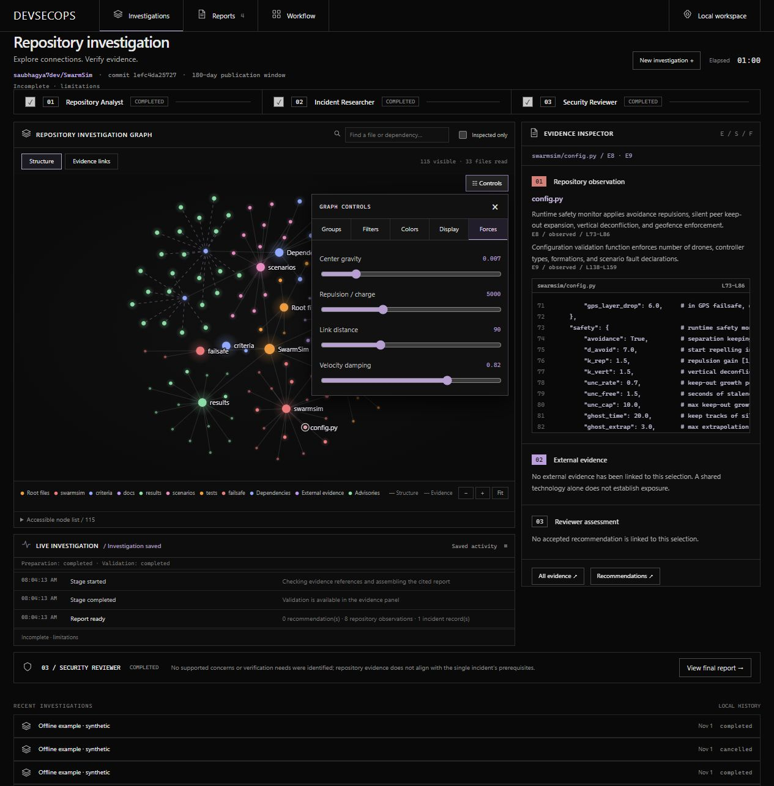

# Investigation workbench

The interface implements the approved black, square-edged design with compact typography, thin straight graph connectors, and softly glowing multicolored nodes. A device-pixel-ratio-aware Canvas 2D renderer now runs the graph locally with spring forces, inverse-square repulsion, center gravity, and velocity damping. It uses the existing HTML, CSS, JavaScript, and same-origin Python API. No React runtime, external font request, or additional package is required.

## Repository graph

- File nodes come from the pinned repository tree and inspected file artifacts. Preparation events reveal successfully read files before the repository artifact is saved.
- Solid lines represent folder membership or grouping of observed technologies. They are not imports, runtime calls, network reachability, or a claim of architectural completeness.
- Evidence mode adds observation and original-report nodes. Dashed lines represent cited associations. A source is connected to repository observations only when an accepted finding references both; retrieval alone does not establish relevance.
- Architecture colors distinguish repository groups. The optional CVSS heatmap colors advisory nodes by their published score; it does not propagate those scores to associated files or claim target exploitability. Uninspected files are dimmed; the selected node has an independent outline.
- Inspected files take priority within a 160-file view. Additional observations and technology/source nodes are bounded separately. Omitted tree entries are counted. Full saved artifacts remain available in the Evidence tab and JSON export.
- Search highlights matches; the inspected-only filter removes uninspected file nodes. Select a node to open its inspector. Drag the background to pan, drag a node to tug its connected neighbors, wheel to zoom around the cursor, or pinch with two touch pointers. HUD +, −, and Fit buttons remain available. Canvas keyboard controls are arrows to pan, +/− to zoom, and 0 to fit. The expandable text node list provides keyboard selection. Hover spotlights direct connections and related reviewer evidence chains while dimming unrelated nodes.

## Graph controls and CVSS provenance

The floating control panel provides keyboard-accessible Groups, Filters, Colors, Display, and Forces tabs:

| Tab | Controls |
| --- | --- |
| Groups | Critical, High, Medium, Low, Clean/CVSS 0, and Unscored checkboxes |
| Filters | Keyword search over names, paths, groups and CVE identifiers; orphans; minimum CVSS |
| Colors | Repository groups, cited service/component layers, or published-CVSS heatmap |
| Display | Node scale, link thickness, hover/large/all labels, candidate attack-path pulses |
| Forces | Center gravity, repulsion charge, link distance, velocity damping, reset |

Service/component-layer coloring uses the analyst component names and their verified observation IDs; nodes without a cited component remain Unmapped. This is a source-based map, not verified deployment topology. Keyword search also covers these component names.

A positive minimum CVSS excludes nodes without numeric scores. Scores belong to advisory nodes; repository files are not declared vulnerable merely because a package name matches. Clean means an explicitly published score of zero, never missing data. Older artifacts remain Unscored when no numeric score was retained.

GitHub's published `cvss_severities` values are retained with score version, vector, provider and advisory ID. Version 4 is preferred where supplied; version 3 is otherwise used. Both ratings survive alias merging. Out-of-range, nonnumeric, boolean, infinite and NaN values are rejected. OSV vector strings and qualitative severity labels are not converted into guessed numeric scores. See [GitHub's global-advisory schema](https://docs.github.com/en/rest/security-advisories/global-advisories). Restart the backend and start a new analysis to collect this metadata; existing saved artifacts are not rewritten.

Path particles animate only reviewer finding/citation links in evidence mode. They depict candidate evidence associations, not confirmed exploit paths. They never run exploits. Architecture/grouping edges and advisory package associations cannot create a verified attack path. Hovering traces related citations without adding new claims.

The simulation reheats after manipulation and settles to rest. Empty/fully filtered graphs do not keep a hot simulation loop. Off-screen or hidden documents pause animation. Once you pan, zoom or grab a node, automatic framing stops so it cannot fight your gesture. Fit restores framing. Reduced-motion preference disables particle pulses.

## Inspector and live progress

The inspector shows selected source code, verified observation IDs and line ranges, associated external passages, and accepted reviewer recommendations. Missing associations stay explicitly absent. Selecting a graph node never runs target code or performs another model request.

The timeline consumes existing server-sent activity events. The original CSS luminance treatment highlights active operation text while the event connection is open. It stops for completed, partial, failed, and cancelled jobs or a disconnected stream. A last-update counter reports event freshness; it is not provider token streaming or private model reasoning. The animation is disabled by `prefers-reduced-motion`.

The reviewer tray reflects the actual reviewer stage. Report download becomes available only when a saved report exists. History, partial results, rejected matches, cancellation, offline examples, and report/JSON exports remain accessible. A saved review starts with its URL form collapsed; New investigation opens it again.

## Verification

- 103 Python tests pass, including same-origin serving of the graph asset.
- Nineteen dependency-free Node tests cover file provenance, preparation events, technology citations, absent incident matches, accepted finding associations, bounded trees, stable finite layouts, score boundaries, orphan filtering, force stability, drag offsets/cancellation, cursor-anchored zoom, two-pointer pinch calculations, empty-graph idling, and 2× pixel-density sizing.
- Browser checks exercised graph search and selection, evidence mode, offline execution, report tabs, active status animation, cancellation, and terminal animation cleanup. CVSS groups, heatmap, numeric thresholds, CVE search, display options, and force reset were also checked using a clearly labeled synthetic local fixture. No browser console errors were observed during these checks. Pointer drag/cancellation and pinch geometry are covered by deterministic handler tests; physical multi-touch hardware has not been tested.
- Responsive controls and a populated 390px-wide viewport are checked for horizontal overflow. Desktop and mobile screenshots were captured from the implementation under `docs/assets/investigation-*.png`.
- UI verification used an isolated local SQLite store with saved public review artifacts and offline fixtures. It consumed no hosted-model or GitHub quota and did not modify existing review records.

The animation is an original CSS implementation of the requested luminous progress treatment; React Bits Pro source was not copied or bundled. Mockup graph labels and illustrative connections are not hardcoded into real reviews. Actual layouts depend on the inspected repository.
