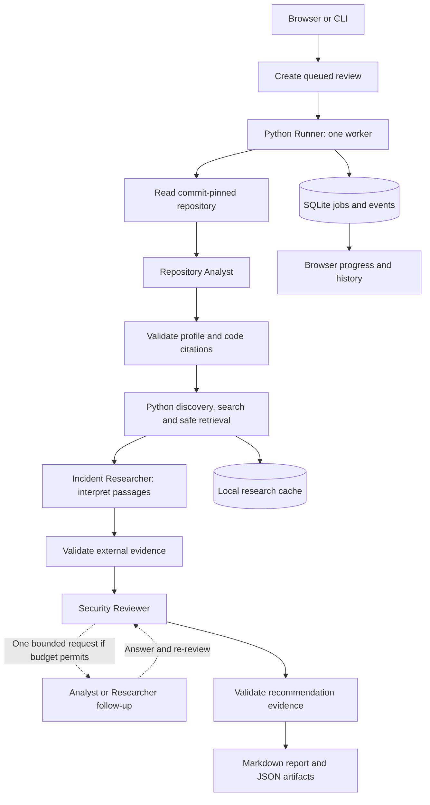

# DevSecOps: Complete Project Guide

Documentation date: 3 November 2026. This guide describes the checked-out implementation. Model names below are **code defaults**, not a guarantee of provider availability or the values in a particular user's `.env`.

## Contents

1. [Purpose and scope](#1-purpose-and-scope)
2. [Project classification](#2-project-classification)
3. [Technology stack](#3-technology-stack)
4. [Architecture and orchestration](#4-architecture-and-orchestration)
5. [Models and role responsibilities](#5-models-and-role-responsibilities)
6. [End-to-end investigation](#6-end-to-end-investigation)
7. [Retrieval and incident discovery](#7-retrieval-and-incident-discovery)
8. [Evidence contracts and validation](#8-evidence-contracts-and-validation)
9. [Reports and interpretation](#9-reports-and-interpretation)
10. [Browser workbench](#10-browser-workbench)
11. [Installation and configuration](#11-installation-and-configuration)
12. [Command-line operation](#12-command-line-operation)
13. [Local HTTP API](#13-local-http-api)
14. [Storage, caching, and lifecycle](#14-storage-caching-and-lifecycle)
15. [Budgets and provider failures](#15-budgets-and-provider-failures)
16. [Security and data boundaries](#16-security-and-data-boundaries)
17. [Source-code map](#17-source-code-map)
18. [Testing and verification](#18-testing-and-verification)
19. [Troubleshooting](#19-troubleshooting)
20. [Limitations and possible extensions](#20-limitations-and-possible-extensions)
21. [Project explanation and related documents](#21-project-explanation-and-related-documents)

## 1. Purpose and scope

DevSecOps is a local, incident-informed repository security review assistant. A user submits a public GitHub repository URL; the application inspects a bounded source snapshot, researches documented external attack mechanisms, and produces a cited Markdown report with structured JSON evidence.

Its central question is:

> Which documented attack mechanisms have prerequisites supported by this repository, and what should its builders verify or change?

The intended users are developers, repository maintainers, and security reviewers who want to connect code observations with external incident evidence. The report helps prioritize investigation and preventive work. It does not establish that an application was compromised or that a vulnerability is exploitable in production.

The application reads source files and configuration. It does not execute the target project, install its dependencies, perform exploitation, modify its files, or deploy fixes. A review may legitimately return zero recommendations.

## 2. Project classification

The most precise description is **an AI-powered application-security assistant with custom sequential multi-agent orchestration and retrieval-augmented analysis**.

| Term | How it applies |
| --- | --- |
| Generative AI / LLM application | Hosted language models interpret code and external evidence and produce structured analysis. |
| Multi-agent orchestration | A Python controller coordinates three specialized model roles, their handoffs, budgets, and optional follow-up. |
| Agentic workflow | Roles perform bounded analysis; the reviewer can request one reexamination. Backend code controls execution and authority. |
| RAG | Retrieved repository text and selected external passages ground model outputs. Retrieval uses deterministic parsing and ranking rather than embeddings. |
| Cybersecurity / application security / DevSecOps tooling | The product applies incident knowledge to static repository review and preventive recommendations. |
| Machine learning | Uses pretrained models; no model training or fine-tuning pipeline is implemented. |
| LangChain / LangGraph | Neither framework is used. The orchestration is ordinary Python code. |
| MCP | No Model Context Protocol client or server is implemented. |
| A2A | No Agent-to-Agent protocol endpoints, discovery, or interoperable task messaging are implemented. |

Multiple roles do not require different models, independent processes, or A2A. Here, agents are role-specific model calls orchestrated inside one application. Calling this a multi-agent workflow is appropriate; describing it as a decentralized autonomous agent network would overstate the implementation.

## 3. Technology stack

| Layer | Implementation |
| --- | --- |
| Runtime | Python 3.11 or later; standard library backend; no third-party runtime packages declared |
| HTTP server | `ThreadingHTTPServer` and `BaseHTTPRequestHandler`, bound to loopback |
| Orchestrator | Custom `Runner`, using a one-worker `ThreadPoolExecutor` |
| Analyst inference | Gemini Developer API `generateContent` |
| Researcher and reviewer inference | Groq's OpenAI-compatible chat-completions endpoint |
| Search | Tavily API, invoked by backend code |
| Repository acquisition | GitHub metadata/tree APIs and commit-pinned raw files |
| Structured discovery | OSV, GitHub global advisories, official MITRE ATT&CK STIX, optional VCDB |
| Persistence | SQLite job/event history and a bounded JSON research cache |
| Frontend | Buildless HTML, CSS, JavaScript; Canvas 2D graph |
| Live progress | Replayable server-sent events (SSE) |
| Export | Markdown report and JSON artifacts |
| Verification | Python `unittest`; dependency-free Node tests |

There is no React requirement, frontend bundler, vector database, external database service, or terminal execution tool available to the model roles.

## 4. Architecture and orchestration



The diagram shows the evidence-bearing path. When no accepted external records are available, the reviewer is skipped and a report can still describe the missing evidence and research limitations. Fatal errors can stop the job before a report exists.

The controller, implemented in [`pipeline.py`](../devsecops/pipeline.py), owns stage transitions, persistence, cancellation checkpoints, and the overall deadline. Each role receives selected input and a required JSON contract. The application validates results before using them downstream.

The roles do not directly contact one another. The reviewer returns a structured follow-up request; Python calls the requested role, validates the referenced IDs, and optionally calls the reviewer again. The first follow-up is considered only when the six-call budget leaves room for both the answer and re-review. Otherwise, the question remains unresolved.

## 5. Models and role responsibilities

Current defaults in [`config.py`](../devsecops/config.py):

| Role | Provider | Default model | Main responsibility |
| --- | --- | --- | --- |
| Repository Analyst | Gemini Developer API | `gemini-3.5-flash-lite` | Map technologies, components, code observations, research questions, and unknowns. |
| Incident Researcher | Groq | `qwen/qwen3.8-27b` | Interpret retrieved external source passages; optionally plan searches when the configured allowance supports it. |
| Security Reviewer | Groq | `openai/gpt-oss-120b` | Compare attack prerequisites against repository observations, defenses, and missing context. |

These identifiers are configured by the project. Provider compatibility, access, quota, and availability must be checked separately. The `openai/` prefix in the reviewer model identifier does not mean this application calls the OpenAI API; that role calls Groq.

### Repository Analyst

Receives a bounded repository tree, coverage metadata, and inspected source text with line numbers. Instructions ask for at most 16 observations, eight technologies, six components, and four research questions. These are prompt limits; local contract validation also applies its own general size limits.

An observation must identify its path, inclusive line range, supporting quote, and whether it is directly observed or inferred. Technologies and components refer back to observation IDs. Loose dependency version ranges must not become exact installed-version claims.

### Incident Researcher

Python performs package parsing, structured discovery, candidate filtering, ranking, page retrieval, caching, and passage selection. Tavily is a search service, not the research LLM.

Below a configured 4,000-token allowance, Python builds search queries deterministically. At the default 1,000-token allowance, Qwen receives a compact interpretation task: a single ranked passage of at most 450 characters, a three-field response contract, and a 192-token output reserve. Python expands this into the full incident representation and supplies the source identity and transmitted quote. Dates and victims remain unknown in this compact mode.

At larger allowances, richer query planning and incident extraction are available within the same global call and context ceilings. Research extraction concerns external evidence; target applicability is the reviewer's responsibility.

### Security Reviewer

Receives reduced, validated profile/research views: at most 16 observations and four incident summaries, with retained supporting quotations. Instructions ask for at most four findings, existing defenses, rejected matches, open questions, and at most one follow-up.

It must distinguish a supported prerequisite from missing deployment evidence, consider counterevidence, and reject claims contradicted by the source. All findings require existing incident and repository evidence IDs.

### Other work

Fetching, parsing, caching, citation checks, report assembly, storage, and graph rendering use ordinary code. Offline mode uses synthetic fixtures and makes no model or research network calls.

**Historical clarification:** earlier versions used one shared OpenAI model setting. The current implementation uses role-specific Gemini/Groq settings; the old `OPENAI_MODEL` and `OPENAI_API_KEY` settings do not configure these roles.

## 6. End-to-end investigation

1. **Submit:** validate a URL shaped like `https://github.com/owner/repository`. Branch paths, queries, fragments, and private repositories are unsupported.
2. **Prepare:** resolve the default branch to a commit SHA and acquire its tree. Read prioritized files from that immutable revision.
3. **Analyze:** generate the repository profile and reject invalid source citations.
4. **Discover:** statically inventory selected Python/npm packages; query official advisory/knowledge sources; build bounded search queries.
5. **Retrieve:** rank candidates, enforce source eligibility and network controls, fetch readable original reports, and select passages.
6. **Extract:** interpret selected external passages, validate quotes, normalize dates, and conservatively deduplicate records. Attempt bounded broader discovery if no usable evidence survives.
7. **Review:** compare accepted external mechanisms with target code evidence. Skip this stage when accepted external records are absent.
8. **Follow up:** reexamine existing evidence when requested and affordable. This does not acquire deployment access or expand permissions.
9. **Validate and report:** reject broken references, downgrade unsupported classifications, render Markdown, and save usage/coverage metadata.

Repository selection favors manifests, lockfiles, READMEs, and security-relevant names such as authentication, routes, upload handlers, configuration, CI workflows, and infrastructure files. Generated/vendor directories, binaries, symlinks, and common secret-file names are excluded. Coverage records distinguish files inspected, truncated, omitted, and unreadable. The selected snapshot is not a complete audit of every file.

## 7. Retrieval and incident discovery

### Discovery channels

| Channel | Purpose | What it cannot prove alone |
| --- | --- | --- |
| OSV | Find advisories for observed packages and versions where available. | That a component is installed, reachable, or exploited. |
| GitHub global advisories | Add advisory ranges, aliases, fixes, references, and published CVSS metadata. | Target exploitability or a documented attack. |
| MITRE ATT&CK | Normalize active technique IDs and identify bounded background/procedure references. | That a technique occurred in this target. |
| VCDB, optional | Retrieve a small set of official historical records through GitHub code search. | Detailed mechanisms or prerequisites absent from sparse records. |
| Tavily | Discover candidate original-report URLs using observed technology/mechanism context. | That a search snippet is valid incident evidence. |

Static package inventory uses already inspected `package.json`, modern `package-lock.json`, Python requirements, `pyproject.toml`, `poetry.lock`, and `uv.lock`. Lockfile versions take precedence over manifest declarations. Exact declaration pins are labeled as declarations, not confirmed installations. The application does not resolve dependency ranges or provide a general cross-ecosystem version solver.

### Original reports and grounding

Source rules in [`sources.py`](../devsecops/sources.py) use specific hosts and paths. Supported sources include CISA, Google Threat Intelligence/Mandiant, Microsoft Security, Google Security Blog, GitHub Security Blog, Cloudflare, Unit 42, The DFIR Report, Wiz, PyPI, and JFrog research.

URLs originate from provider metadata or normalized official references. A URL merely written by a model is not accepted as evidence. Homepages, indexes, tutorials, and payload downloads are filtered. The original URL and final redirect must satisfy report eligibility. Retrieved HTML prefers article/main text; navigation and scripts are omitted. PDF, binary, and JavaScript-only sources are unsupported.

The default discovery window is 180 days by publication date. One reserved deterministic fallback removes the date filter when retrieval or validated extraction yields no usable records. A broader mechanism query may use the remaining search slot. All attempts remain within the original ceilings; undated or older evidence retains explicit labels.

Publication date, incident date, and retrieval timestamp are separate fields. Whitespace-normalized contiguous source quotes must be 40–800 characters and present in retained text. This proves reference integrity, not the correctness of the model's interpretation.

Structured advisories, background techniques, historical records, and narrative records remain separate report/artifact sections. Narrative records themselves distinguish observed attacks, vulnerability advisories, and background guidance. The existence of a record is not a claim that the target was breached.

For detailed acquisition rules, fallback logic, and discovery budgets, see [Incident discovery](incident-discovery.md).

## 8. Evidence contracts and validation

[`contracts.py`](../devsecops/contracts.py) defines strict JSON schemas for profiles, search plans, compact/full incident extraction, reviews, and follow-ups. Local validation checks required fields, unexpected fields, types, enums, and general array/string bounds even if provider-side structured output is enabled.

| Reference | Meaning |
| --- | --- |
| `E1`, `E2`, … | Repository observations with source locations |
| `S1`, `S2`, … | Retrieved external sources |
| `I1`, `I2`, … | Accepted external narrative records |
| `F1`, `F2`, … | Recommendation IDs used by the review contract/convention |

Repository checks require an inspected path, valid line range, unique valid observation ID, and quote matching the corresponding lines after whitespace normalization. Redacted lines cannot support accepted observations. Technologies/components with invalid evidence references are removed.

Research checks require a known source, unique valid incident ID, and a matching quote. Supporting secondary quotes are independently checked. Invalid/future dates become unknown or receive appropriate labels; a publication date is never automatically treated as an incident date.

Review checks require nonempty valid incident/evidence references, action, and verification text. A supported concern based only on inferred observations becomes **Needs verification**. A supported concern relying only on background guidance becomes **Background lesson**. Defense and rejected-match references are also filtered.

These checks do not implement semantic proof, a vulnerability solver, or a guarantee that all prose claims follow from the quoted passage.

## 9. Reports and interpretation

| Classification | Interpretation |
| --- | --- |
| Supported concern | Directly observed repository evidence supports a relevant prerequisite. Remaining exploit conditions still require review. |
| Needs verification | The connection depends on missing version, configuration, deployment, or control evidence. |
| Background lesson | Useful external context without sufficient support for a target concern. |

Impact and confidence are separate qualitative labels: High, Medium, or Low. They are not calibrated probabilities. Published CVSS belongs to advisory metadata, not automatically to repository files or model findings.

A recommendation includes its mechanism, prerequisite, code and incident references, explanation, counterevidence, missing information, preventive action, and safe verification step. The report also includes overview, coverage, research evidence, structured discovery, existing defenses, rejected matches, open questions, and provenance where available.

| Saved artifact | Contents |
| --- | --- |
| `repository` | Commit identity, bounded tree, inspected source, skipped files, coverage |
| `profile` | Technologies, components, observations, questions, unknowns |
| `research` | Retrieved sources, external records, packages, advisories, techniques, history, mappings, coverage and limitations |
| `review` | Findings, defenses, rejected matches, unresolved questions, or an explicit skipped result |
| `followup`, optional | Request/answer, or failure details |
| `validation` | Warnings, configured models, per-role usage, request/retry counts, selected-context metadata and interpretation limits |

No accepted findings means that none were established within this review's coverage. It does not certify security. A partial report must be read with its saved limitations.

## 10. Browser workbench

The local workspace provides repository submission, recent investigations, five stage cards, a live operation timeline, graph inspection, result tabs, cancellation, offline examples, and Markdown/JSON export.

The graph is rendered locally with Canvas 2D and bounded force simulation. Solid edges show folder/group membership, not imports or runtime reachability. Dashed evidence edges represent cited associations; an external source connects to repository observations only when accepted reviewer findings reference both.

Controls include text search, inspected-only filtering, CVSS groups/thresholds, group/component/score colors, labels, force settings, pan, zoom, node dragging, fit, and a keyboard-accessible node list. File display is bounded to 160 entries, prioritizing inspected files, with separate bounds for other nodes. Missing entries remain available through the saved evidence where retained.

CVSS coloring uses published numeric advisory scores. An unscored node is not a clean node. Candidate-path animation illustrates finding/citation associations, not a verified exploit path. Selecting nodes does not trigger code execution or new inference.

The Report tab shows read-only Markdown beside a rendered preview with optional proportional scroll synchronization. The renderer supports the report's Markdown subset; raw HTML remains text, external images are not fetched, and unsafe link targets are rejected.

Progress events describe observable operations and completed outputs. They are neither streamed model tokens nor private reasoning. Reduced-motion preferences disable relevant animations. See [Investigation workbench](investigation-workbench.md) for controls and screenshots.

## 11. Installation and configuration

Requirements: Python 3.11+, a browser for the UI, and internet access/credentials for live operation. Git is needed only to clone; Node.js is optional for frontend checks.

From the project directory:

```powershell
python run.py
```

Open [http://127.0.0.1:8765](http://127.0.0.1:8765). Use **Explore an offline example** to inspect synthetic output without credentials.

For a new installation without an existing `.env`:

```powershell
Copy-Item .env.example .env
```

If `.env` already exists, merge the required fields into it. Example placeholders:

```dotenv
GEMINI_API_KEY=your-gemini-key
GROQ_API_KEY=your-groq-key
TAVILY_API_KEY=your-tavily-key
ANALYST_MODEL=gemini-3.5-flash-lite
RESEARCHER_MODEL=qwen/qwen3.8-27b
REVIEWER_MODEL=openai/gpt-oss-120b
RESEARCHER_TOKEN_BUDGET=1000
ENABLE_VCDB=0
GITHUB_TOKEN=
PORT=8765
```

| Setting | Behavior |
| --- | --- |
| `GEMINI_API_KEY` | Required for live Analyst inference. |
| `GROQ_API_KEY` | Required for live Researcher and Reviewer inference. |
| `TAVILY_API_KEY` | Required for live search. |
| `ANALYST_MODEL`, `RESEARCHER_MODEL`, `REVIEWER_MODEL` | Override model identifiers; providers remain fixed per role. |
| `RESEARCHER_TOKEN_BUDGET` | Positive conservative allowance; default 1,000. Increase only to match verified account limits. |
| `ENABLE_VCDB` | Set to `1` to enable optional historical discovery. |
| `GITHUB_TOKEN` | Optional for public GitHub API access; required for VCDB code-search discovery. |
| `PORT` | Default local port; `--port` overrides it. |

Existing process environment values take precedence over `.env`. Restart the server after configuration changes. Credential presence means configured, not verified access. Keep real credentials out of version control and browser inputs.

The source package metadata currently says `0.1.0`, while the README badge says `0.1.8`. This guide does not resolve that existing version-label inconsistency.

## 12. Command-line operation

```powershell
# Start the web workspace, optionally on another port.
python run.py
python run.py --port 8766

# Produce synthetic Markdown and neighboring JSON without hosted calls.
python run.py --demo --output test-output/example.md

# Analyze a public repository using configured hosted services.
python run.py --repo https://github.com/owner/repository --output test-output/report.md

# Equivalent module entry point.
python -m devsecops --demo --output test-output/example.md

# Make small live integration checks; consumes API quota.
python run.py --check-apis
```

The normal CLI review uses a fixed 180-day window. The local API accepts 7–730 days; the UI offers its own preset choices. CLI reports are written to the selected path with JSON at the same basename. A CLI export can exist for a partial report; the main CLI's exit status is not a complete-report quality guarantee.

`--check-apis` independently checks the three model roles, Tavily, and GitHub. It prints PASS/FAIL/MISSING and exits nonzero when a check fails or credentials are missing. Small-request success does not establish that full-repository context will fit or that future requests will succeed.

For explicit live batch verification, the repository includes:

```powershell
python tools/verify_repositories.py --live --output test-output/live-check https://github.com/owner/repository
```

This utility runs actual reviews, consumes quota, and saves an isolated output database and summaries. Partial/failed results give a nonzero batch exit code. It is separate from offline tests.

## 13. Local HTTP API

Base address: `http://127.0.0.1:8765` unless a different port is selected.

| Method | Endpoint | Purpose |
| --- | --- | --- |
| GET | `/api/config` | Public role/search configuration, missing credential names, live-ready flag, request token, demo URL |
| GET | `/api/jobs` | Latest 50 job summaries |
| POST | `/api/jobs` | Queue a live or demo investigation |
| GET | `/api/jobs/{id}` | Job state, artifacts, report and errors |
| GET | `/api/jobs/{id}/events` | SSE activity stream |
| POST | `/api/jobs/{id}/cancel` | Request cooperative cancellation |
| GET | `/api/jobs/{id}/report` | Download Markdown; 409 when unavailable |
| GET | `/api/jobs/{id}/artifacts` | Download JSON evidence |
| GET | `/api/storage` | History/event counts, active count and cache size |
| POST | `/api/storage/clear` | Clear explicit history/cache/all scope with confirmation |

Example submission body:

```json
{
  "mode": "live",
  "repository_url": "https://github.com/owner/repository",
  "days": 180
}
```

Mutations require the `X-Review-Token` obtained from `/api/config`; this is a local request-protection token, not a provider key. POST bodies must be nonempty JSON objects and at most 4,096 bytes. Cancellation uses a JSON body such as `{}`.

A successful submission returns HTTP 202 with an `id`. Invalid requests return 400; failed local request protection returns 403; missing jobs return 404; missing credentials/report availability or active-job cleanup conflicts can return 409; a full queue returns 429. The submission guard counts active entries in the latest-50 job listing and rejects when five are active there.

SSE activity events carry monotonically assigned event IDs and stage/title/detail/timestamp data. Clients can resume with `Last-Event-ID` or `?after=...`; a finished event signals terminal completion for that stream. Reconnection replays retained events.

Cleanup requires a body such as `{"scope":"cache","confirmation":"CLEAR"}`. It is destructive application cleanup with no application undo and is blocked while any job is active. The UI supplies the confirmation flow.

## 14. Storage, caching, and lifecycle

Default local storage:

```text
.devsecops/
  reviews.sqlite3       Jobs, reports, artifacts, replayable events
  research-cache/       Bounded digest-named JSON cache entries
test-output/            Default CLI/testing exports
```

SQLite uses WAL mode. Jobs are JSON records with ID, URL, mode, window, timestamps, status, stage states, artifacts, report, and error. Events live in a separate sequenced table. Default runtime data and `.env` are ignored by Git.

| Job status | Meaning |
| --- | --- |
| queued | Waiting for the single worker |
| running | Processing stages |
| cancelling | Stop requested; waiting for a checkpoint |
| cancelled | Worker stopped; saved evidence retained |
| completed | Report saved without the pipeline's partial-result triggers |
| partial | Report saved with validation warnings or incomplete research conditions |
| failed | Fatal error prevented normal completion |

Stages can additionally be skipped or partial. A completed status is workflow completion, not proof of full source coverage or semantic accuracy. Closing the browser does not cancel work. Cancellation and the 900-second deadline are cooperative; an in-flight call may finish before stopping.

Server startup marks interrupted active jobs found in the recent-job listing as failed while retaining evidence. Recovery currently iterates the latest 50 jobs rather than scanning every historical row; there is no automatic resume.

The cache has a 24-hour TTL, at most 64 JSON entries, and a 2 MB entry ceiling. It stores bounded metadata, normalized knowledge, fetched text, and extraction results. Full STIX bundles and search snippets are not stored as evidence. Extraction keys account for model, schema, instructions, selected content, and token configuration; cached results are validated again. Cache hits retain original acquisition timestamps.

Expiry is a freshness rule, not secure deletion. Cleanup preserves repository source, credentials/settings, and exports outside application history. Cache cleanup skips symlinks and unrelated filenames; SQLite cleanup attempts compaction but does not promise forensic erasure.

## 15. Budgets and provider failures

| Resource | Implemented ceiling/default |
| --- | --- |
| Inspected repository files | 36 |
| Per-file acquisition | 64,000 bytes |
| Per-file retained source | 9,000 characters, truncated at complete lines |
| Repository retained source | 100,000 characters |
| Saved tree paths / skipped details | First 600 paths / 300 skipped entries |
| Logical model calls | Six across all roles |
| Retry attempts for models | One per request, at most three retries per job |
| Tavily requests | Three, including retries and fallback |
| Narrative fetch attempts / stored sources | Six / six |
| Narrative response / retained text | 8 MB / 18,000 characters per page |
| Extraction selection | 6,000 source characters total, at most two sequential batches |
| Groq serialized request body | 18,000 UTF-8 bytes |
| Structured discovery requests | Twelve, including retries |
| Dataset downloads | Two within the structured budget, 64 MB per dataset |
| Package inventory / queried packages | 24 / three |
| Merged structured advisories | 24 |
| Research cache | 24-hour TTL, 64 entries, 2 MB per entry |
| Overall review | 900 seconds, cooperatively enforced |

Resource categories have separate ceilings; structured discovery does not expand model/search/fetch budgets. The reviewer is reserved a call when extraction is considered. More expensive research may leave no room for follow-up and re-review.

Researcher input is conservatively estimated from UTF-8 bytes divided by two, plus an output reserve. This is not a provider tokenizer. Requests are locally reduced or blocked before transmission when they exceed limits. Estimated attempts, including retries, share a job allowance of three times `RESEARCHER_TOKEN_BUDGET`; a process-local rolling-minute pacer also controls sequential researcher usage. Other programs using the account are outside this estimate.

Model HTTP 429 retries require a short provider reset and exclude oversized requests/daily exhaustion. HTTP 503 receives one bounded retry, honoring a short reset or using a small jittered wait. Long waits, invalid access, and persistent failures are surfaced. Search and structured API retry policies have separate budgets. No automatic provider/model switch or offline-example substitution conceals a failure.

Failed research preserves available artifacts and can yield a partial report with skipped review. An initial analyst failure can terminate the job before research. Failed follow-up/re-review retains the earlier review, records unresolved questions, and downgrades supported concerns as appropriate.

## 16. Security and data boundaries

| Boundary | Implemented protection | Practical limit |
| --- | --- | --- |
| Target acquisition | Public repositories, fixed commit, bounded text reads; no target execution/install/write tools | Static coverage cannot establish deployment behavior. |
| HTTPS reader | Public-IP resolution and connection pinning, TLS hostname validation, port 443, response limits, redirect checks | These controls do not establish source truth. |
| Network destinations | Reject local/private/reserved addresses and credential-bearing URLs | Availability still depends on DNS, connectivity and upstream services. |
| Redirects | Revalidate destinations; do not follow POST redirects; remove Authorization on GET redirects | Eligible original-report rules still need separate enforcement. |
| Secrets | Exclude common sensitive paths and redact suspect lines while retaining line numbering | Pattern matching can miss secrets; it is not complete DLP. |
| Prompt injection | Treat retrieved files/pages as untrusted evidence; fixed role instructions, strict output contracts, backend-controlled tools | Models can still misinterpret malicious or misleading content. |
| Local browser API | Loopback binding, Host/Origin checks, cross-site rejection, request tokens for mutations | No production multi-user authentication or authorization system. |
| Browser rendering | Restrictive CSP, escaped text, bounded Markdown subset and safe links | Browser protections do not validate recommendation semantics. |
| Error reporting | Safe status/quota details; avoid logging keys/raw provider errors | Local artifacts still contain analyzed source and findings. |

The app runs locally, but live inference is hosted. Selected repository content and analysis context are sent to Gemini/Groq; search queries are sent to Tavily. GitHub and allowed report hosts receive retrieval requests. Local operation does not mean all data processing stays on the machine. The project does not establish provider retention policies.

The loopback server is a development/local application. Internet-facing deployment would need a separate authentication, transport, isolation, storage, and operational design.

## 17. Source-code map

| File or directory | Responsibility |
| --- | --- |
| `run.py`, `devsecops/__main__.py` | Launch web server, CLI reviews, demo and API checks |
| `devsecops/config.py` | Environment loading, role defaults, settings and global limits |
| `devsecops/server.py` | Local API, static routes, same-origin protection, SSE, storage actions |
| `devsecops/pipeline.py` | Queue worker, stage orchestration, cancellation, persistence and report completion |
| `devsecops/agents.py` | Role instructions and analysis/review/follow-up functions |
| `devsecops/providers.py` | Gemini/Groq/Tavily adapters, usage tracking, retry and researcher pacing |
| `devsecops/contracts.py` | JSON schemas and local structural validation |
| `devsecops/repository.py` | URL parsing, snapshot acquisition, file selection and coverage |
| `devsecops/network.py` | Bounded public HTTPS, upstream error normalization and redaction |
| `devsecops/incident_research.py` | Research control flow, acquisition, extraction, fallback and deduplication |
| `devsecops/sources.py` | Original-report host/path eligibility and candidate normalization |
| `devsecops/packages.py` | Static Python/npm inventory and version uncertainty |
| `devsecops/discovery.py` | Structured discovery budgets and advisory normalization/merging |
| `devsecops/knowledge.py` | Official ATT&CK normalization, bounded technique/history discovery |
| `devsecops/context.py` | Passage ranking, token estimates, reduced researcher/reviewer views |
| `devsecops/cache.py` | Expiring bounded research cache and cleanup |
| `devsecops/evidence.py` | Reference validation, classification downgrades and Markdown report assembly |
| `devsecops/store.py` | SQLite jobs/events, transitions, history and cleanup |
| `devsecops/demo.py` | Fictional offline fixtures |
| `devsecops/diagnostics.py` | Small live integration checks |
| `web/index.html`, `web/styles.css`, `web/app.js` | Browser layout, styling, state, requests and investigation views |
| `web/graph.js` | Canvas graph model, simulation and interaction |
| `web/markdown.js` | Local report Markdown renderer |
| `tests/` | Python fixtures and Node frontend tests |
| `tools/verify_repositories.py` | Explicit live batch verification utility |
| `docs/` | Design, verification notes, examples, screenshots and this guide |

## 18. Testing and verification

Run from the project root:

```powershell
python -m unittest discover -v
node --check web/app.js
node --check web/graph.js
node --check web/markdown.js
node --test tests/test_graph.cjs tests/test_markdown.cjs
```

Python fixtures exercise contracts, citations, source eligibility, structured discovery, package uncertainty, caching, provider failures, retry/token guards, orchestration, API protections, diagnostics, and storage cleanup. Node tests cover graph provenance/layout/interactions and report rendering/unsafe content. These are local fixtures, not a fresh hosted-provider benchmark.

The [31 October live verification record](live-verification-2026-10-31.md) documents four public-repository runs with all three hosted roles. Two finished completed and two partial; all four returned zero accepted findings. The record explicitly identifies weak source matching and narrow compact-mode coverage. Those runs establish successful execution for the sampled account/configuration, not reliable matching accuracy or absence of vulnerabilities.

[Gemini availability notes](gemini-availability.md) document separate provider failures: a tiny successful request did not establish full-snapshot availability. Historical checks do not guarantee current model access.

## 19. Troubleshooting

| Symptom | Interpretation and next step |
| --- | --- |
| Live mode reports missing credentials | Merge required fields into `.env`, check process-environment precedence, restart. |
| Model metadata is reachable but analysis fails | Metadata access differs from inference; inspect role/model error and test small/full workloads separately. |
| HTTP 503 | Provider unavailable; bounded retry may fail. Retry later or explicitly choose a compatible role model. |
| HTTP 429, request exceeds allowance | Waiting cannot make an intrinsically oversized request fit. Check context and verified account limits. |
| Daily quota exhausted | Wait for reset or change account limits; the app does not silently switch providers. |
| GitHub request limit exhausted | Observe the reported reset; optionally configure `GITHUB_TOKEN` and restart. |
| Reviewer skipped | No accepted external records, upstream failure, or lack of usable evidence; inspect research outcome/coverage. |
| Report is partial | Read rejected citations, failed acquisitions, provider errors and omissions. Available artifacts remain useful for inspection. |
| No findings | None established within coverage; do not interpret as a security clearance. |
| Missing repository files | Inspect exclusions, priority ordering, tree truncation and file/context budgets. |
| Unrelated external reports | Discovery/extraction can produce weak matches, especially with compact context. Inspect passages and rejected matches. |
| Cancel seems delayed | The worker stops at cooperative checkpoints after the in-flight call finishes or fails. |
| Refreshed page shows old errors | Saved jobs are historical; restart for code/config changes and create a new investigation. |
| API POST returns 403 | Obtain a fresh local request token and use the correct same-origin loopback address. |
| Cleanup blocked | A queued/running/cancelling investigation still exists; finish or cancel it first. |
| Port already in use | Select another port with `python run.py --port 8766`. |

## 20. Limitations and possible extensions

Current limitations include bounded file and package coverage, no complete dependency resolution, no verified runtime topology, no exploit execution, no production configuration discovery, no calibrated confidence scores, and no semantic proof of findings. The application does not provide compliance certification, SBOM completeness, continuous runtime monitoring, private-repository support, or PDF extraction.

The current researcher's default small allowance substantially limits passage interpretation and may leave dates/victims unknown. Advisory/package similarities and ATT&CK candidates can be useful leads while remaining insufficient to establish applicability. An exact quote can still be interpreted incorrectly.

Possible extensions, **not implemented commitments**, include representative matching-quality evaluations, richer evidence selection within verified quotas, additional ecosystem parsers, private-source authorization, PDF ingestion, configurable role providers, and production deployment controls. MCP or A2A could be added for external interoperability if needed; neither is necessary for the existing internal workflow. A vector index could support repeated corpus retrieval, but is not required for this bounded RAG implementation.

## 21. Project explanation and related documents

One-sentence explanation:

> DevSecOps coordinates three specialized AI roles to compare a public GitHub repository's code evidence with documented external attack mechanisms and produce cited preventive recommendations with explicit uncertainty.

Technical explanation:

> A standard-library Python orchestrator acquires a commit-pinned repository snapshot, invokes role-specific Gemini/Groq models, performs backend-controlled Tavily and official-source discovery, validates structured evidence handoffs, and persists reports/events in SQLite for a buildless browser workbench and CLI.

Related documents:

- [README and quick start](../README.md)
- [Product scope and acceptance criteria](../MVP.md)
- [Incident discovery and evidence boundaries](incident-discovery.md)
- [Investigation workbench](investigation-workbench.md)
- [Live integration verification, 31 October 2026](live-verification-2026-10-31.md)
- [Gemini availability troubleshooting](gemini-availability.md)
- [Role-model research notes, 28 October 2026](llm-role-research-2026-10-28.md)
- [Version-one development journey](version-1-journey.md)
- [Synthetic offline report](examples/offline-report.md) and [JSON artifacts](examples/offline-report.json)

Implementation files are the authority for current behavior. Historical research and verification notes record the circumstances of their checks; they are not present-day provider guarantees.
