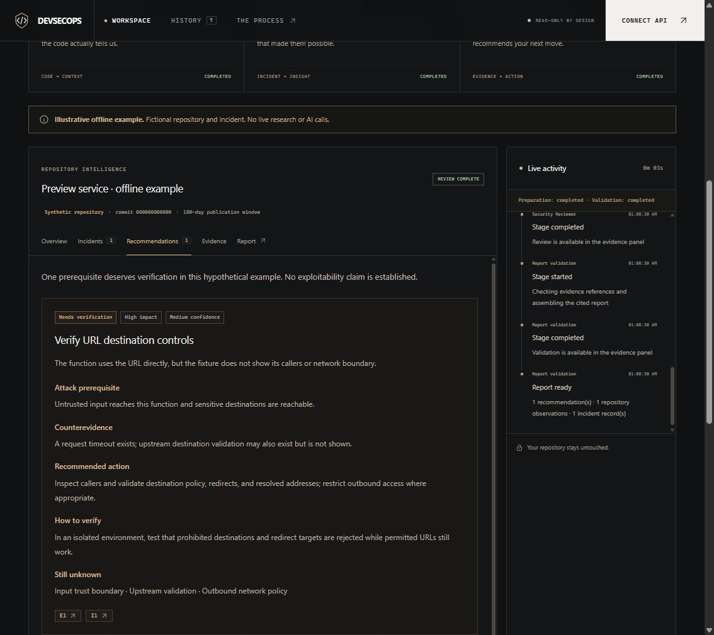
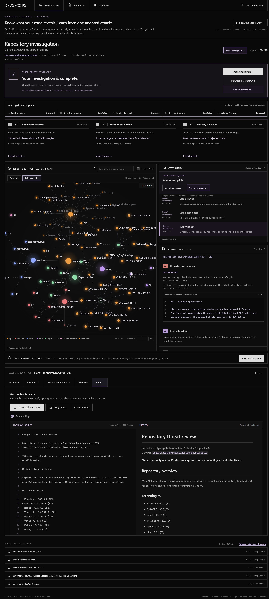

# DevSecOps — The journey to Version 1

**V1 milestone: 2 November 2026** · From autonomous patching concept to a working, read-only investigation workspace.

## How the idea changed

We started with a vulnerability remediation network: ingest CVEs, use repository context to assess impact, delegate patches, test them in staging, and eventually merge fixes. We then broadened the question beyond dependency vulnerabilities: **what can builders learn from documented attacks before facing a similar threat?**

The first version took a concrete shape: give the system one public GitHub URL and receive a cited Markdown report connecting repository observations with external security evidence. Automatic patching and deployment stayed outside this version's scope.

## Build timeline

| When | What changed |
| --- | --- |
| **27–28 October** | Repository initialized and MVP defined. Built commit-pinned repository reading, three specialized roles, structured handoffs, citation checks, SQLite history, live activity, cancellation, and an offline example. |
| **28 October** | Shipped the first saved dashboard design: a dark, warm-accented workspace with results tabs and an activity timeline. |
| **30 October** | Replaced the shared OpenAI setup with Gemini for repository analysis, Groq for research/review, and Tavily for search. Added independent API diagnostics. |
| **30–31 October** | Worked through quota, token-budget, availability, and GitHub-rate-limit failures. Improved bounded incident discovery with OSV/GitHub advisories, ATT&CK background, ranked source passages, caching, and explicit partial/skipped states. Recorded live repository checks. |
| **1 November** | Rebuilt the interface around an Obsidian-style Canvas graph: glowing nodes, physics, drag/pan/zoom, filters, force controls, and an Evidence Inspector. Added visible agent outputs, a square graph with activity on the right, interactive Workflow, completion/report actions, and history/cache cleanup. |
| **1 November** | Added numbered Markdown source beside a rendered report preview, optional synchronized scrolling, and all-node labels by default. The verified suite reached **134 passing tests: 111 Python + 23 JavaScript**. |
| **2 November** | Marked this as the first complete product version, using the completed investigation shown below. More upgrades will follow. |

*Implementation dates follow the repository's recorded commit dates; the V1 milestone is the owner's designation, not a new package-version release.*

## First saved look → current V1

**Early dashboard · 28 October.** Results-first layout with warm accents. This screenshot uses an explicitly fictional offline example.

**Current V1 · supplied 2 November.** Black graph-first workspace, visible agent work, evidence inspection, a clear completion state, and source/preview reporting.

## Where we landed

**Public repository → Repository Analyst → Incident Researcher → Security Reviewer → validated, cited report.** Retrieval grounds the agents in selected source passages; Python checks quotations and evidence references. This is multi-agent orchestration with structured handoffs, not an A2A protocol or vector-database implementation.

V1 offers a complete investigation flow, not a guarantee of security. It does not execute repository code, prove production exposure, run exploits, patch files, or deploy changes. A completed investigation may correctly produce zero recommendations when evidence does not support a connection—as the current screenshot shows.

See the [README](../README.md) for setup and architecture, and the [workbench notes](investigation-workbench.md) for interface behavior and verification.
